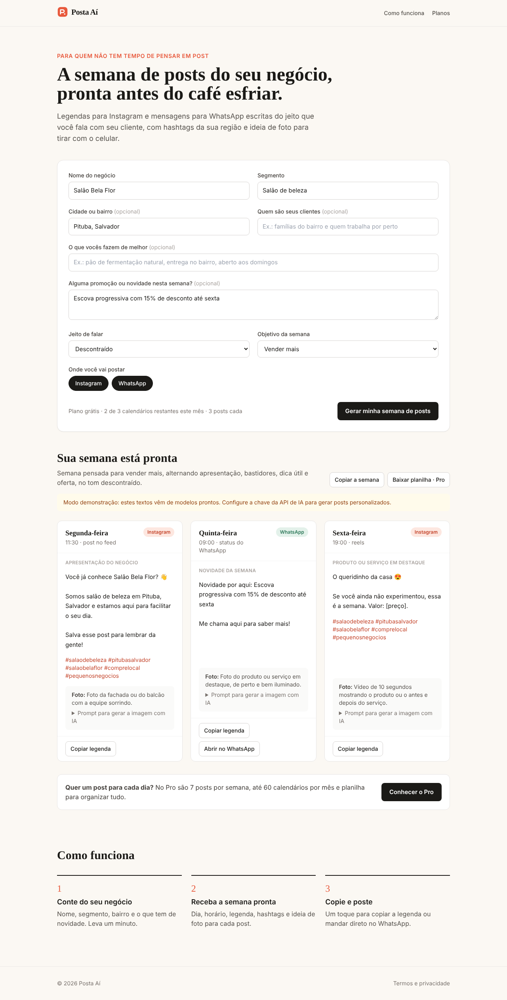
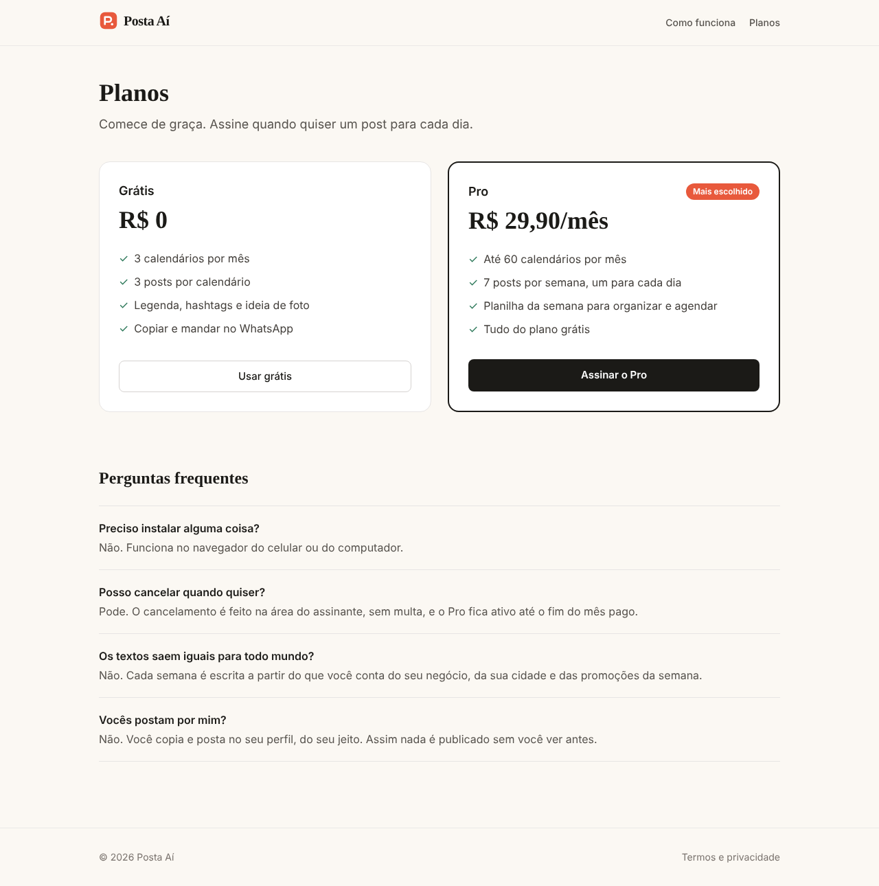

# Posta Aí

Micro-SaaS que monta a semana de posts de pequenos negócios para Instagram e WhatsApp.
O dono conta o nome, o segmento, o bairro e as novidades da semana, e recebe um
calendário com dia, horário, formato, legenda, hashtags, chamada para ação e ideia de foto
para cada post.

- **Grátis:** 3 calendários por mês, 3 posts cada.
- **Pro (R$ 29,90/mês):** até 60 calendários por mês, 7 posts por semana e planilha (CSV) da semana.

Feito com Next.js 15 (App Router), Tailwind, a API do Claude (saída estruturada validada com Zod)
e Stripe Checkout. Não usa banco de dados: o uso do mês e a assinatura ficam num cookie
assinado com HMAC.



<p>
  
  
</p>

## Rodar localmente

```bash
npm install
cp .env.example .env.local   # preencha o que tiver
npm run dev
```

Sem `ANTHROPIC_API_KEY` o app roda em **modo demonstração**, com textos montados a partir de
modelos prontos, para testar o fluxo inteiro sem gastar nada.

```bash
npm test         # testes do núcleo (sessão, limites, demo, exportação)
npm run build
```

## Variáveis de ambiente

| Variável | Obrigatória | Para quê |
| --- | --- | --- |
| `SESSION_SECRET` | sim, em produção | Assina o cookie de uso e assinatura. Gere com `openssl rand -base64 32`. |
| `ANTHROPIC_API_KEY` | para IA real | Chave da API do Claude ([console.anthropic.com](https://console.anthropic.com)). |
| `AI_MODEL` | não | Modelo usado. Padrão `claude-opus-5-5`; `claude-haiku-5-5` sai bem mais barato. |
| `STRIPE_SECRET_KEY` | para cobrar | Chave secreta do Stripe. |
| `STRIPE_PRICE_ID` | para cobrar | ID do preço recorrente mensal do plano Pro (BRL). |
| `NEXT_PUBLIC_SITE_URL` | para cobrar | URL pública, usada no retorno do checkout. |
| `UPSTASH_REDIS_REST_URL` / `UPSTASH_REDIS_REST_TOKEN` | não | Limite do plano grátis também por IP, para quem tentar burlar limpando cookies. |

## Publicar na Vercel

1. Importe o repositório na Vercel (framework detectado automaticamente).
2. Defina pelo menos `SESSION_SECRET`. Com só ela, o site já funciona em modo demonstração.
3. Adicione `ANTHROPIC_API_KEY` para gerar posts com IA.
4. No Stripe, crie um produto "Posta Aí Pro" com preço recorrente mensal de R$ 29,90, copie o ID
   do preço para `STRIPE_PRICE_ID` e coloque `STRIPE_SECRET_KEY` e `NEXT_PUBLIC_SITE_URL`.
5. Ative o portal do cliente no Stripe (Configurações → Billing → Customer portal) para o
   botão "Gerenciar assinatura" funcionar.

## Como funciona por dentro

- `src/app/api/gerar` valida o formulário, confere o limite do plano, chama a IA (ou o gerador
  de demonstração) e devolve o calendário.
- `src/lib/ia.ts` tem o prompt e a chamada ao Claude com saída em JSON validada pelo schema de
  `src/lib/schema.ts`. Em modelos que aceitam, pedidos recusados caem automaticamente num
  modelo alternativo do próprio servidor da Anthropic.
- `src/app/api/checkout` abre o Stripe Checkout; a volta passa por `/sucesso`, que confirma o
  pagamento em `api/assinatura/confirmar` e grava o Pro no cookie. Uma vez por dia o status da
  assinatura é reconferido no Stripe, então cancelamentos são respeitados.

## Limitações conhecidas do MVP

- O Pro fica ligado ao navegador onde a pessoa pagou. Para usar em outro aparelho, o próximo
  passo é login por e-mail (link mágico) guardando o ID do cliente do Stripe.
- Sem histórico de calendários gerados; a pessoa copia ou baixa a planilha na hora.
- Pagamento só por cartão (assinatura recorrente). Pix recorrente exigiria Mercado Pago ou similar.
